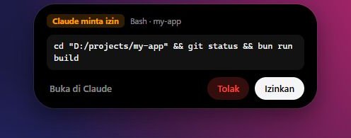
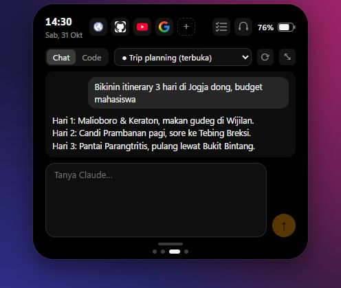
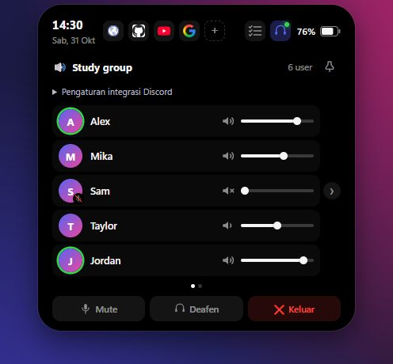
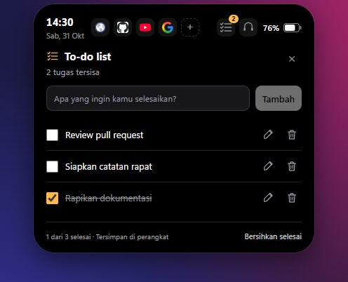
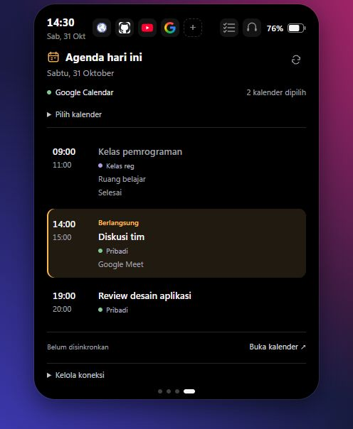
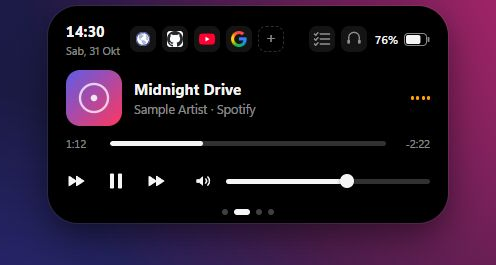
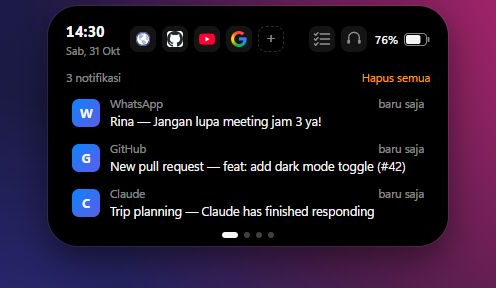
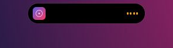
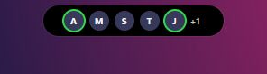

# FloatingBar

**Answer Claude’s Yes/No prompts from a floating bar on Windows.** Review a permission request, then click **Izinkan** (allow) or **Tolak** (deny) without switching windows. FloatingBar also brings together Claude chat, Discord voice controls, to-dos, Google Calendar, music, and notifications.

Built with Tauri 2 (Rust) and React + TypeScript.

[Baca dalam Bahasa Indonesia](README.id.md)

<p align="center">
  
</p>

**Main feature: review Claude’s command and answer Allow / Deny from the pill.**

| Claude | Discord voice |
| :---: | :---: |
|  |  |

| To-do list | Google Calendar |
| :---: | :---: |
|  |  |

<details>
<summary>More previews</summary>

| Music | Notifications |
| :---: | :---: |
|  |  |

| Compact music | Compact Discord |
| :---: | :---: |
|  |  |

</details>

<sub>All screenshots use fictional demos, with no personal chats, calendar events, profile photos, accounts, or credentials.</sub>

> FloatingBar is an independent project. It is not affiliated with Apple or Anthropic. The interface text is currently in Indonesian.

---

## Contents

- [Features](#features)
- [Requirements](#requirements)
- [Install](#install)
- [Using FloatingBar](#using-floatingbar)
- [Discord panel](#discord-panel)
- [To-do list and Google Calendar](#to-do-list-and-google-calendar)
- [Claude integration](#claude-integration)
- [Optional: show notifications only in FloatingBar](#optional-show-notifications-only-in-floatingbar)
- [Configuration and data files](#configuration-and-data-files)
- [Privacy and security](#privacy-and-security)
- [Known limitations](#known-limitations)
- [Troubleshooting](#troubleshooting)
- [Uninstall](#uninstall)
- [Build from source](#build-from-source)
- [How it works](#how-it-works)
- [Contributing](#contributing)
- [License](#license)

## Features

- **Claude Yes/No approvals**: answer **Allow / Deny** for Claude desktop prompts and Claude Code hooks.
- **Discord voice**: members, speaking indicators, mute/deafen, per-member volume, compact avatars, and pin.
- **Daily planning**: local to-dos and today’s events from selected Google calendars, including shared calendars.
- **Floating pill** at the top center of the screen that expands on hover, with spring animations. Drag it anywhere; it remembers where you left it.
- **Click-through**: the empty area around the pill never blocks the apps underneath.
- **Now playing** from any app that reports to Windows media controls (Spotify, YouTube in a browser, media players): artwork, title, artist, progress, play/pause/next/previous.
- **Per-app volume**: the slider (or scrolling over the pill) changes the volume of the app that is playing, not the whole system.
- **Notifications**: Windows notifications appear as cards on the pill, and the Notifications page keeps the last 20.
- **Shortcuts**: one-click launchers for websites, apps or programs, configured in a JSON file.
- **Battery and clock** at a glance.
- **Claude panel**: pick Chat or Code mode and a conversation in the Claude desktop app, read its recent messages, send prompts (with a pasted image) and follow the reply — all from the pill.
- **Tray icon** with show/hide, reset position, autostart and quit. Only one instance runs at a time.

## Requirements

- Windows 10 or 11 (developed and tested on Windows 11).
- Microsoft Edge WebView2 Runtime (included with Windows 11; the installer adds it on Windows 10 if missing).
- For the Claude features: the [Claude desktop app](https://claude.ai/download) with its interface in English.

## Install

Download `FloatingBar_<version>_x64-setup.exe` (or the `.msi`) from the [Releases](https://github.com/orkvacy/floatingbar/releases) page and run it. Windows SmartScreen may warn that the app is unrecognized because the installer isn't code-signed; choose **More info → Run anyway** if you trust the source.

Or [build it yourself](#build-from-source).

After installing:

1. **Allow notification access** so FloatingBar can read notifications: *Settings → Privacy & security → Notifications* → turn on **Let apps access your notifications** (wording varies by Windows version). If access is missing, the expanded pill shows a hint in orange.
2. Optional: right-click the tray icon → **Jalan saat Windows start** (run at startup).
3. Optional: [let notifications pop up only in FloatingBar](#optional-show-notifications-only-in-floatingbar).

## Using FloatingBar

### The pill

| Action | What it does |
| --- | --- |
| Hover the pill | Expands it. It shrinks again shortly after the cursor leaves. |
| Drag the top header (or the compact pill) | Moves the window. Its position is saved. Dragging page content changes slides instead. |
| Double-click the header | Moves it back to the top center of the screen. |
| Scroll up/down over the pill | Changes the volume of the playing app (on the Music page or while collapsed). |
| Hold the left mouse button and drag page content horizontally; or use touchpad swipe / Shift + scroll | Switches pages without moving the bar. |
| Click the dots under a page | Jumps to that page. |

While collapsed, the pill shows the album art and a small equalizer when something is playing, or the clock and battery otherwise. It opens by itself for a few seconds when you plug in the charger.

### Pages

The expanded pill has four pages, left to right:

1. **Notifications** — the last 20 notifications with app icon and time. Click one to remove it, or *Hapus semua* to clear them. The list lives in memory only and is empty again after a restart.
2. **Music** — artwork, title, artist, progress bar, previous/play-pause/next, and a volume slider with mute. This is the page shown first.
3. **Claude** — see [Claude integration](#claude-integration).
4. **Agenda** — today’s events from selected Google calendars (optional sign-in).

The header on every page shows the clock, date, your shortcuts and the battery level.

### Notification cards

New notifications show as a card on the pill for about 6 seconds (longer while the cursor is on it). Click the card to dismiss it. Notifications take priority over the music view; permission prompts take priority over notifications.

### Volume

Volume applies to the app that owns the playing media: Spotify, Chrome, Edge, Firefox, Opera, Brave, VLC and any app whose media session names its `.exe`. For other apps (for example the Windows Media Player app), the slider controls the system volume. Hover the slider to see which one it controls.

Windows treats all tabs of a browser as one audio source, so a browser's volume affects every tab of that browser. To control music separately, play it in a different browser or app than the one you use for other sound.

### Shortcuts

The icons in the header open websites, apps or programs. Click **+** in the header (or tray → *Atur shortcut…*) to edit the list in Notepad; changes appear the next time the pill opens. See [shortcuts.json](#shortcutsjson).

### Tray menu

The tray icon may be hidden behind the **^** arrow in the taskbar; drag it out to keep it visible.

- **Left click** — show or hide the pill.
- **Right click** — menu:
  - *Sembunyikan pill / Tampilkan pill* — hide or show the pill
  - *Kembalikan ke tengah atas* — move it back to the top center
  - *Atur shortcut…* — edit shortcuts
  - *Jalan saat Windows start* — start with Windows (checkmark shows the current state)
  - *Keluar* — quit

Launching FloatingBar again while it runs just brings the pill back.

Near the bottom of a monitor, the pill expands upward. Its window is constrained to the monitor’s work area, including the taskbar boundary; long panels scroll when space is limited.

## Discord panel

Open Discord desktop, then the headset panel in FloatingBar. Under **Pengaturan integrasi Discord**, enter your own application’s Client ID and Client Secret from Discord Developer Portal, save, and authorize in Discord. Voice RPC depends on Discord application access; restricted applications may require your account to be registered as a tester. New source and installers contain no bundled Discord credentials. Credentials and tokens are stored on this device using Windows DPAPI encryption. Use these settings again after rotating your secret.

With the Discord panel selected and voice active, leaving the pill collapses it to member avatars. Hover to expand again. The **pin** button at the panel’s top right keeps it expanded; toggle it off to restore automatic collapse. Compact mode shows up to five avatars plus an overflow count, with a green ring for speaking members.

Per-member volume sliders stay within their rows, including when pagination arrows are visible.

## To-do list and Google Calendar

The checklist icon to the left of Discord opens a local to-do list: add, edit, complete, delete, or clear completed tasks. Tasks persist in this device’s WebView storage. Close the panel with its icon or × button.

Page four, **Agenda**, shows today’s events from **selected Google calendars**, including shared/subscribed calendars, all-day and recurring events, times, locations, and links. Dates and times follow the computer’s timezone. Events refresh on opening the active page and every minute while active. Open **Pilih kalender** to select sources locally; initial selection follows Google Calendar. Each event names its source. A separate account merely signed in to your browser is not automatically accessible: share or subscribe to its calendar from the connected account, or use **Hubungkan ulang / ganti akun** to replace the connected account. Manual refresh and disconnect controls are included. Same-day results remain visible with an error message if a refresh fails.

One-time setup:

1. Enable **Google Calendar API** in a project in [Google Cloud Console](https://console.cloud.google.com/apis/library/calendar-json.googleapis.com).
2. Configure the OAuth consent screen; add your email as a **test user** if the app is in Testing.
3. Create an OAuth client of type **Desktop app** and download its credentials JSON.
4. In FloatingBar, open **Agenda → Hubungkan Google Calendar** and select the JSON file (or paste it).
5. Complete sign-in in your default browser and grant calendar read access. Never commit the downloaded credentials file.

The app uses OAuth Authorization Code + PKCE, a local loopback callback, and only the read scopes `calendar.events.readonly` and `calendar.calendarlist.readonly`. Existing users can click **Perbarui izin Google** to authorize calendar-list access without importing their JSON again. Cancelling reauthorization preserves the old connection. Tokens and client credentials are encrypted with Windows DPAPI in `%APPDATA%\id.orkvacy.floatingbar\google-calendar.dat`. Tokens never enter the frontend. **Kelola koneksi → Putuskan koneksi** removes the local token; **Kelola izin di Google** opens Google’s access management page for full revocation. Testing-mode tokens may require reauthorization.

Account integration is desktop-only. Browser previews support `?demo=calendar` with clearly separate sample events and `?demo=todos` for the task panel.

## Claude integration

These features work with the [Claude desktop app](https://claude.ai/download) and with Claude Code. FloatingBar controls the app through Windows UI Automation (the accessibility API screen readers use) by reading its English labels, so a redesign of the Claude app can break them until FloatingBar is updated.

### Claude panel

On the Claude page:

1. Choose **Chat** or **Code**. This switches the mode in the Claude app.
2. Pick a conversation from the list (taken from the app's sidebar), or **＋ Chat baru / Sesi baru** for a new one. The conversation open in the app is selected automatically and marked **● … (terbuka)**. Picking one opens it in the app and loads its last 12 messages into the panel.
3. Type a prompt and press **Enter** to send (**Shift+Enter** for a new line). FloatingBar opens the conversation in the app, fills in the prompt, presses Send, and shows the reply as Claude writes it.

Other controls:

- **⟳** reloads the conversation list.
- **⤢ / ⤡** switches between compact and tall. You can also drag the handle at the bottom to any height; double-click it to reset. The size is remembered.
- **Paste an image** (Ctrl+V) into the prompt box to attach it. On send, FloatingBar brings the Claude window to the front for a moment and pastes the image there with Ctrl+V. The image is taken from the clipboard at that moment, so don't copy anything else in between.

The panel stays open while you type or while Claude is replying. If the Claude app isn't running, the panel offers to open it.

> Sending to the conversation that is open in the app adds your message to that conversation. Choose **＋ Chat baru** to start fresh.

### Answering permission prompts

FloatingBar can answer two kinds of permission prompts. In both cases the card on the pill offers **Izinkan** (allow), **Tolak** (deny) and **Buka di Claude** (answer in Claude instead).

**Prompts in the Claude desktop app** (for example a connector tool in Chat) are picked up automatically: FloatingBar watches the app for an *Allow once / Decline* prompt and presses the matching button when you answer on the pill.

**Claude Code prompts** (desktop Code tab or the `claude` CLI) use a Claude Code hook. Add this to `~/.claude/settings.json` (merge it with any `hooks` you already have):

```json
{
  "hooks": {
    "PermissionRequest": [
      {
        "hooks": [
          {
            "type": "http",
            "url": "http://127.0.0.1:47821/permission",
            "timeout": 60,
            "statusMessage": "Waiting for an answer in FloatingBar…"
          }
        ]
      }
    ]
  }
}
```

With the hook in place, each permission request appears on the pill with the tool name, the project folder and the command or file. If you don't answer within 55 seconds, if the pill is hidden, or if FloatingBar isn't running, Claude Code falls back to its normal prompt. To turn this off, remove the `PermissionRequest` block from the settings file.

## Optional: show notifications only in FloatingBar

By default Windows still shows its own notification banners in the corner. The script `scripts/quiet-windows-notifications.ps1` turns those banners off so notifications pop up only on the pill. It changes only your user settings (no admin rights) and can be undone at any time.

Run it from the project folder in PowerShell:

```powershell
# 1. Preview what would change, without changing anything
powershell -ExecutionPolicy Bypass -File scripts\quiet-windows-notifications.ps1 -WhatIf

# 2. Apply
powershell -ExecutionPolicy Bypass -File scripts\quiet-windows-notifications.ps1

# 3. Restore everything to how it was before
powershell -ExecutionPolicy Bypass -File scripts\quiet-windows-notifications.ps1 -Undo
```

What it does:

- For every app that has sent notifications before, turns off the **pop-up banner** (`ShowBanner = 0` under `HKCU\Software\Microsoft\Windows\CurrentVersion\Notifications\Settings\<app>`). Notifications still go to the notification center, which is where FloatingBar reads them. Apps whose notifications are already fully turned off are left alone.
- Turns off **flashing taskbar buttons** (`TaskbarFlashing = 0` under `HKCU\Software\Microsoft\Windows\CurrentVersion\Explorer\Advanced`, Windows 11 22H2 and later), so an auto-hidden taskbar doesn't pop up when an app wants attention. Add `-KeepTaskbarFlashing` to skip this.
- Saves the previous values to `%APPDATA%\id.orkvacy.floatingbar\quiet-notifications-backup.json`. Running the script again keeps the original values, so `-Undo` always restores your real starting point.

Good to know:

- Apps that send their **first** notification after you ran the script still show banners. Run it again to quiet them.
- If banners still appear, **sign out and back in** so Windows reloads the settings.
- Don't turn notifications off completely in Windows Settings: FloatingBar would receive nothing either.

**Without the script**, you can do the same by hand:

- *Settings → System → Notifications → (an app)* → turn off **Show notification banners**, keep **Show notifications in notification center** on. Repeat per app.
- Or turn on **Do not disturb** in *Settings → System → Notifications* and switch off its automatic schedules.
- *Settings → Personalization → Taskbar → Taskbar behaviors* → turn off **Show flashing on taskbar apps**.

To restore by hand, turn those options back on.

## Configuration and data files

FloatingBar stores its files in `%APPDATA%\id.orkvacy.floatingbar\`:

| File | Purpose |
| --- | --- |
| `shortcuts.json` | Header shortcuts. Created with defaults on first use. |
| `position.json` | Where you dragged the pill. Delete it to reset. |
| `discord-client.dat` | Discord Client ID/secret, encrypted with DPAPI. |
| `discord-token.dat` | Discord token, encrypted with DPAPI. |
| `google-calendar.dat` | Google credentials and tokens, encrypted with DPAPI. |
| `quiet-notifications-backup.json` | Created only by the optional script, used by `-Undo`. |

The Claude panel height is kept in the app's WebView storage under `%LOCALAPPDATA%\id.orkvacy.floatingbar\`.

### shortcuts.json

A list of shortcuts, shown left to right:

```json
[
  { "name": "GitHub", "target": "https://github.com" },
  { "name": "WhatsApp", "target": "whatsapp:" },
  { "name": "Notepad", "target": "C:\\Windows\\notepad.exe" },
  { "name": "Docs", "target": "https://example.com", "icon": "https://example.com/logo.png" }
]
```

- `name` — shown as a tooltip.
- `target` — a URL, an app protocol (such as `whatsapp:`) or a path to a program or file. It is opened the same way Windows opens it from the Run dialog.
- `icon` (optional) — an image URL. Websites default to their favicon; other targets show the first letter of the name.

If the file contains invalid JSON, the defaults are shown until it's fixed.

## Privacy and security

- **Discord**: voice uses local Discord IPC; OAuth token exchange contacts Discord over HTTPS. Legacy plaintext tokens are migrated after encrypted storage succeeds.
- **WebView storage**: to-dos, selected calendars, and Claude panel height remain local. DPAPI files can only be decrypted by the same Windows account.
- **Local data stays on your computer.** FloatingBar has no telemetry and sends your notifications, media info or Claude conversations nowhere. The optional calendar integration contacts Google after you connect your Google account.
- **Network requests**: shortcut icons for websites are loaded from Google's favicon service (`https://www.google.com/s2/favicons?domain=…`), which tells Google which domains are in your shortcuts. Set an `icon` for a shortcut to avoid this.
- **Notifications** are read from the Windows notification center while FloatingBar runs and kept in memory only; nothing is written to disk.
- **Claude app**: FloatingBar reads the Claude window's accessibility tree locally — button labels about every 1.5 seconds to spot permission prompts, and conversation text while you use the Claude panel. Sending a prompt with an image briefly focuses the Claude window and uses your clipboard.
- **Local permission endpoint**: FloatingBar listens on `http://127.0.0.1:47821` (only reachable from this computer) for the Claude Code hook. It has no authentication: another program on your computer could post a request and make a card appear, but nothing is approved unless you click **Izinkan**, and the answer only goes back to whoever asked.
- **Startup**: *Jalan saat Windows start* adds an entry under `HKCU\Software\Microsoft\Windows\CurrentVersion\Run`; turning it off removes it.

## Known limitations

- Windows only.
- The Claude features depend on the Claude app's English interface labels and may need an update after the app changes.
- When sending to Claude in Chat mode, a long pause in the middle of a reply can make FloatingBar consider the reply finished early. Open the conversation again (pick it from the list) to load the rest.
- A browser's volume covers all of its tabs (see [Volume](#volume)).
- The taskbar flashing switch in the optional script targets Windows 11 22H2 and later and hasn't been confirmed on every build; where Windows uses a different setting, it simply has no effect. The manual setting is listed in that section.
- Some apps don't provide a logo for their notifications; FloatingBar then shows the first letter of the app name.
- The interface is in Indonesian.

## Troubleshooting

**Discord is disconnected while I am in voice.**
Keep Discord desktop running, configure the integration in the headset panel, then reconnect. After rotating credentials, save the new secret and authorize again. Your Discord application still needs RPC access.

**Another account’s calendar is missing.**
Share/subscribe to that calendar from the connected account, update Google permissions if prompted, then select it under **Pilih kalender**. Signing in to another browser account alone does not grant this app access.

**Notifications don't appear on the pill.**
Make sure notification access is allowed (see [Install](#install)); the expanded pill shows an orange hint when it isn't. Notifications must be enabled in Windows Settings — only the banners may be off.

**The pill doesn't show up.**
Check the tray icon: left-click it to show the pill, or right-click → *Kembalikan ke tengah atas*. If you moved the pill to a monitor that is no longer connected, it returns to the top center on the next start.

**Opening FloatingBar does nothing.**
Another instance is already running (maybe a development build); launching again only brings that one back. Quit it from the tray first.

**The pill is empty after Windows starts.**
Autostart was turned on from a development build, which loads its interface from the dev server. Turn autostart off, install a release build, and turn it on from there.

**The Claude panel says the app isn't open, or the list doesn't match the app.**
Start the Claude desktop app and press **⟳**. If it still fails, the app's interface may have changed; please [open an issue](https://github.com/orkvacy/floatingbar/issues).

**Permission prompts don't reach the pill.**
For Claude Code, check the hook in `~/.claude/settings.json` (valid JSON, port `47821`) and that FloatingBar is running and visible. Claude Code reads settings at session start, so start a new session after editing.

## Uninstall

1. If you used the optional script, restore your notification settings first:
   ```powershell
   powershell -ExecutionPolicy Bypass -File scripts\quiet-windows-notifications.ps1 -Undo
   ```
2. Turn off *Jalan saat Windows start* in the tray menu.
3. Remove the `PermissionRequest` hook from `~/.claude/settings.json` if you added it.
4. Uninstall FloatingBar from *Settings → Apps → Installed apps*.
5. Optionally delete `%APPDATA%\id.orkvacy.floatingbar` and `%LOCALAPPDATA%\id.orkvacy.floatingbar`.

## Build from source

### Prerequisites

1. **Microsoft C++ Build Tools** with the *Desktop development with C++* workload:
   ```powershell
   winget install Microsoft.VisualStudio.2022.BuildTools --override "--wait --passive --add Microsoft.VisualStudio.Workload.VCTools --includeRecommended"
   ```
2. **Rust** via rustup:
   ```powershell
   winget install Rustlang.Rustup
   ```
3. **Bun**:
   ```powershell
   winget install Oven-sh.Bun
   ```

Open a new terminal afterwards so `cargo` and `bun` are on the PATH.

### Commands

```powershell
bun install            # install frontend dependencies
bun run tauri dev      # run the desktop app with hot reload (the first Rust build takes a while)
bun run dev            # run only the interface in a browser, with sample data
bun run tauri build    # build the installers
```

The installers are written to `src-tauri\target\release\bundle\nsis\` (`.exe`) and `src-tauri\target\release\bundle\msi\` (`.msi`).

Only one FloatingBar runs at a time, so quit an installed copy before running the dev build (and the other way around).

## How it works

```
src/                     React interface
  App.tsx                pill, pages and cards
  lib/calendar.ts        Google Calendar state and sample agenda
  lib/discord.ts         Discord voice state and fictional demo members
  lib/todos.ts           local task storage
  lib/native.ts          hooks that talk to the Rust side (and sample data in a browser)
  icons.tsx, styles.css
src-tauri/src/           Rust backend
  lib.rs                 window setup, click-through hover, saved position, commands
  calendar.rs            Google OAuth PKCE and selected-calendar agenda
  discord.rs             Discord IPC, OAuth, reconnect and voice controls
  placement.rs           work-area bounds and expansion direction
  secure_store.rs        Windows DPAPI encrypted storage
  media.rs               now playing via Global System Media Transport Controls
  audio.rs               per-app volume via Core Audio sessions
  battery.rs             battery via GetSystemPowerStatus
  notify.rs              notifications via UserNotificationListener
  permission.rs          local HTTP endpoint for the Claude Code PermissionRequest hook
  ui_permission.rs       Claude app permission prompts via UI Automation
  claude_app.rs          Claude panel: mode, conversations, sending, reading replies
  ask.rs                 claude:// deep link fallback
  shortcuts.rs           shortcuts.json and launching targets
  tray.rs                tray icon, autostart, single instance
scripts/
  quiet-windows-notifications.ps1   optional notification banner switch
  capture-screenshots.ps1           regenerates docs/screenshots from the demo mode
```

- **Window and click-through.** The window is transparent, frameless, always on top and larger than the pill so the pill can grow. It ignores the mouse by default; a Rust thread polls the cursor position and accepts input only while the cursor is over the pill area the interface reports.
- **Polling.** Windows only sends change events for these APIs to packaged apps, so FloatingBar polls instead: media every 0.7 s, notifications every 0.8 s, battery every 3 s, Claude prompts every 1.5 s.
- **UI Automation work** runs on dedicated threads that own their COM objects; the interface sends them requests through channels.
- **Logos of packaged apps** (such as Claude) are read from the app's install folder, because reading them through the WinRT logo stream can hang.

## Contributing

Issues and pull requests are welcome.

1. Fork and clone the repository, then follow [Build from source](#build-from-source).
2. Use `bun run dev` for interface work: it runs in a normal browser with sample data. Try `mockNotify()` and `mockPermission()` in the browser console, or open a demo state directly with `?demo=` and one of `compact`, `music`, `notifications`, `notification`, `permission`, `claude`, `todos`, `calendar`, `calendar-setup`, `discord` or `discord-compact` (for example `http://localhost:1420/?demo=claude`).
   To refresh the README screenshots, keep the dev server running and run `powershell -ExecutionPolicy Bypass -File scripts\capture-screenshots.ps1`; it saves them to `docs/screenshots` using headless Edge.
3. Before opening a pull request, make sure `bun run build` (type check + build) and `cargo build --manifest-path src-tauri/Cargo.toml` pass.
4. Commit messages follow [Conventional Commits](https://www.conventionalcommits.org/), for example `feat(media): …` or `fix(notifications): …`.

If the Claude app changes its interface, the labels FloatingBar looks for are collected at the top of `src-tauri/src/claude_app.rs` and in `src-tauri/src/ui_permission.rs`.

Maintainers: see the [release and pre-push checklist](docs/RELEASING.md) and prepared [v0.2.0 release notes](docs/releases/v0.2.0.md).

## License

FloatingBar is open source under the [MIT License](LICENSE): you may use, modify and share it, including commercially, as long as the copyright notice is kept. It comes without any warranty.
