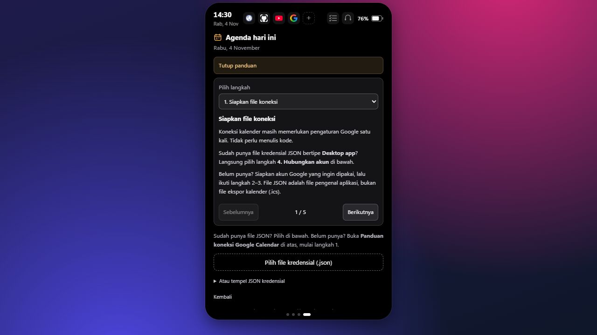
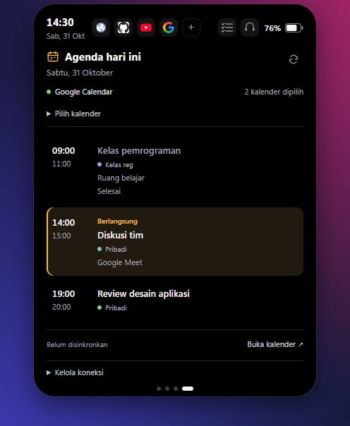
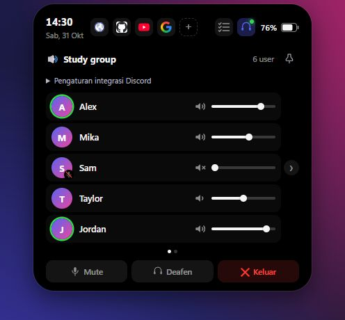
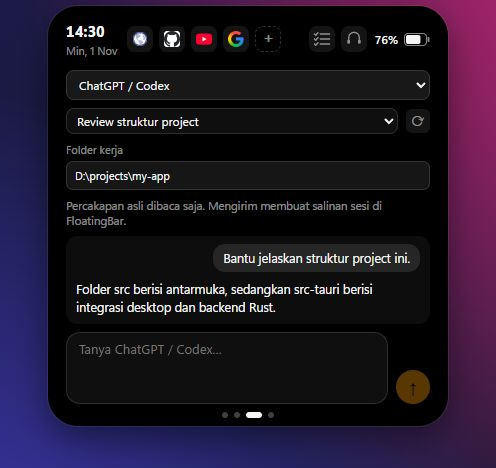

# Panduan koneksi FloatingBar

Panduan ini untuk aplikasi Windows. Buka **Panduan koneksi** pada halaman Agenda, panel Discord, atau panel ChatGPT / Codex untuk mengikuti petunjuk tanpa meninggalkan FloatingBar. Panel tetap terbuka selama panduan dibaca. Semua integrasi opsional; to-do list dapat dipakai tanpa akun.

## Google Calendar

Tujuan: menampilkan **agenda hari ini** dari kalender yang Anda pilih. FloatingBar hanya meminta akses baca acara dan daftar kalender, tidak mengubah atau menghapus acara.

### Sudah punya file JSON?

1. Buka halaman **Agenda** (halaman keempat).
2. Klik **Hubungkan Google Calendar → Pilih file kredensial (.json)**.
3. Pilih file OAuth bertipe **Desktop app**, bukan file ekspor kalender `.ics` atau JSON service account.
4. Browser akan terbuka. Pilih akun yang diizinkan memakai proyek Google tersebut, periksa aplikasi dan akses yang diminta, lalu setujui akses baca.
5. Kembali ke FloatingBar dan buka **Pilih kalender**. Centang kalender yang ingin ditampilkan.

Koneksi berhasil saat sumber **Google Calendar**, jumlah kalender dipilih, dan waktu pembaruan muncul. Agenda kosong dapat berarti belum ada acara hari ini.

### Belum punya file JSON?

Versi ini masih memerlukan pengaturan Google Cloud satu kali. Anda tidak perlu menulis kode, tetapi harus dapat membuat proyek Google. Jika akun kampus/kantor membatasinya, hubungi administrator atau gunakan akun pribadi yang diizinkan.

1. Buka [Google Cloud Console](https://console.cloud.google.com/). Pada pemilih proyek di bagian atas, pilih **New project / Proyek baru**. Beri nama dan pilih proyek tersebut.
2. Buka **APIs & Services → Library**, cari **Google Calendar API**, lalu klik **Enable / Aktifkan**.
3. Buka **Google Auth platform → Branding**. Mulai konfigurasi dan isi nama aplikasi, email dukungan, serta email kontak.
4. Untuk akun pribadi, pilih **External** di Audience. Saat proyek berstatus **Testing**, masukkan email akun yang akan login melalui **Audience → Test users → Add users**.
5. Pada **Data Access → Add or Remove Scopes**, cari izin `calendar.events.readonly` dan `calendar.calendarlist.readonly`. Pilih kedua izin baca tersebut dan simpan.
6. Buka **Clients → Create client**, pilih **Desktop app**, beri nama, lalu buat client. Unduh JSON dari detail client, kemudian ikuti bagian **Sudah punya file JSON?** di atas.

Nama menu dapat berbeda sesuai bahasa atau pembaruan Google. Simpan JSON secara lokal; jangan unggah ke repository atau kirim lewat chat. Jika ada peringatan aplikasi belum diverifikasi, periksa proyek dan pemiliknya sebelum melanjutkan. Jangan lanjutkan untuk aplikasi yang tidak Anda kenal.

Rujukan: [menyiapkan Calendar API dan client desktop](https://developers.google.com/workspace/calendar/api/quickstart/python#authorize_credentials_for_a_desktop_application), [konfigurasi Audience dan izin](https://developers.google.com/workspace/guides/configure-oauth-consent). Panduan ini tidak memerlukan instalasi Python; rujukan dipakai untuk langkah konfigurasi Google.

### Kalender dari akun lain

Berpindah akun di situs Google Calendar tidak otomatis menghubungkan akun kedua ke FloatingBar. Bagikan kalender dari akun pemilik ke akun yang terhubung, terima undangan berbagi, lalu perbarui agenda dan centang kalender tersebut. Kebijakan kampus/kantor dapat membatasi berbagi atau detail acara yang bisa dibaca.

Untuk mengganti akun utama, pilih **Kelola koneksi → Hubungkan ulang / ganti akun**. Anda tidak perlu memilih ulang JSON selama konfigurasi aplikasi masih tersedia.

### Bantuan masalah umum

| Yang terlihat | Yang perlu diperiksa |
| --- | --- |
| Agenda kosong | Tanggal acara harus hari ini; centang kalender yang benar. Klik tombol Perbarui agenda. |
| Kalender bersama tidak muncul | Periksa akun penerima, undangan berbagi, dan akses kalender. Jika tersedia, klik **Perbarui izin Google**. |
| Login ditolak / access_denied | Pastikan akun tercantum di Test users untuk proyek Testing. Periksa kebijakan administrator. |
| File JSON ditolak / redirect_uri_mismatch | Gunakan OAuth client **Desktop app** dari proyek yang API Calendar-nya aktif. |
| Koneksi perlu login ulang | Gunakan **Hubungkan ulang / ganti akun**. Izin yang dicabut atau token aplikasi Testing dapat memerlukan login ulang. |
| Browser ditutup saat login | Klik **Batalkan login**, lalu ulangi proses saat siap. |

**Putuskan koneksi** menghapus token lokal. Untuk mencabut akses dari Google, gunakan **Kelola izin di Google**.

## Discord

1. Buka **Discord desktop** di Windows dan masuk voice channel. Discord di browser saja tidak menyediakan koneksi desktop ini.
2. Di [Discord Developer Portal](https://discord.com/developers/applications), pilih/buat aplikasi dan temukan **Client ID** serta **Client secret** pada bagian OAuth2. Gunakan pasangan dari aplikasi yang sama.
3. Di FloatingBar, klik ikon headset → **Pengaturan integrasi Discord**. Isi keduanya, lalu klik **Simpan dan hubungkan**.
4. Periksa permintaan otorisasi di Discord dan setujui jika aplikasinya sesuai.
5. Saat terhubung ke voice, nama channel dan anggota tampil di FloatingBar.

Client secret berbeda dari bot token atau password akun. Jangan membagikannya. Jika secret direset, simpan penggantinya melalui pengaturan integrasi yang sama. Jika tidak terhubung, periksa Discord desktop, pasangan kredensial, otorisasi, dan akses RPC/tester aplikasi. [Discord membatasi akses RPC selama pengembangan](https://docs.discord.com/developers/topics/rpc#restrictions); koneksi tidak dijamin tersedia untuk setiap aplikasi/akun.

## ChatGPT / Codex

1. Pasang **Codex CLI untuk Windows** mengikuti [panduan resmi OpenAI](https://developers.openai.com/codex/cli). Jalankan `codex` dan selesaikan login. Jika belum terbiasa memakai terminal, minta bantuan saat instalasi.
2. Buka ulang FloatingBar → halaman **AI → ChatGPT / Codex** → **Muat ulang Codex**.
3. Pilih percakapan atau sesi baru. Untuk sesi baru, isi **Folder kerja** dengan alamat folder yang sudah ada di komputer.
4. Ketik prompt dan kirim. Balasan muncul di panel; permintaan izin yang didukung dapat dijawab dengan Izinkan/Tolak.

Login situs ChatGPT saja belum cukup. Panel menggunakan akun/config Codex CLI, bukan impor riwayat ChatGPT biasa. Pengiriman dari percakapan lama membuat salinan sesi; izin hanya mencakup sesi yang dijalankan lewat FloatingBar.

Jika CLI tidak ditemukan, pastikan dapat dijalankan di Windows, lalu buka ulang FloatingBar. Lokasi khusus dapat menggunakan `FLOATINGBAR_CODEX_BIN` berisi path absolut `codex.exe` seperti dijelaskan dalam [integrasi AI](AI-PERMISSIONS.md). Jangan isi dengan token atau password. Daftar percakapan kosong dapat diatasi dengan membuat sesi baru; periksa pesan error sebelum mengulang prompt agar tidak mengirim dua kali.

[Kembali ke README](../README.id.md)
